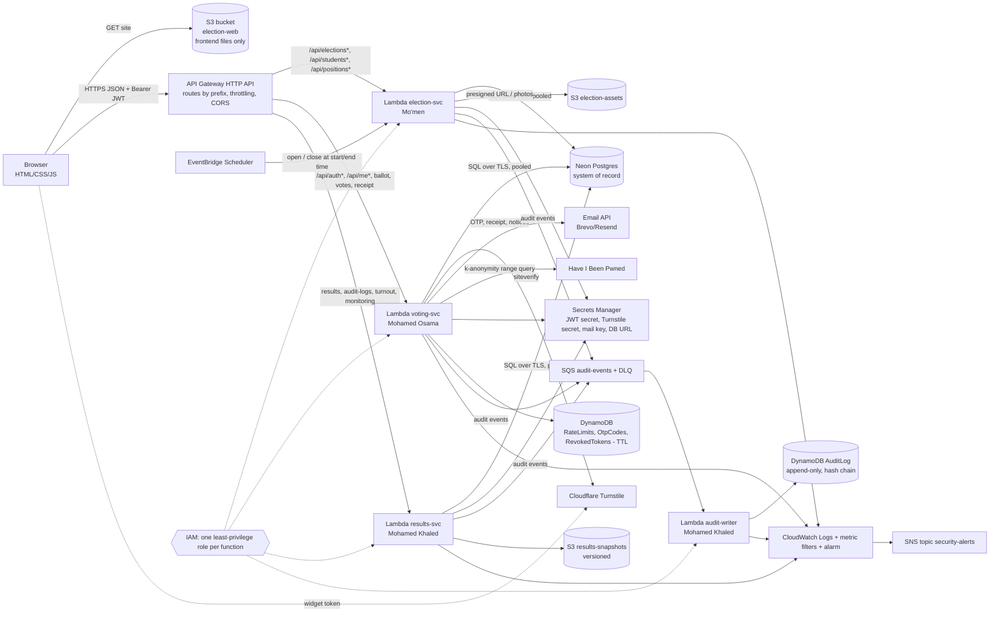
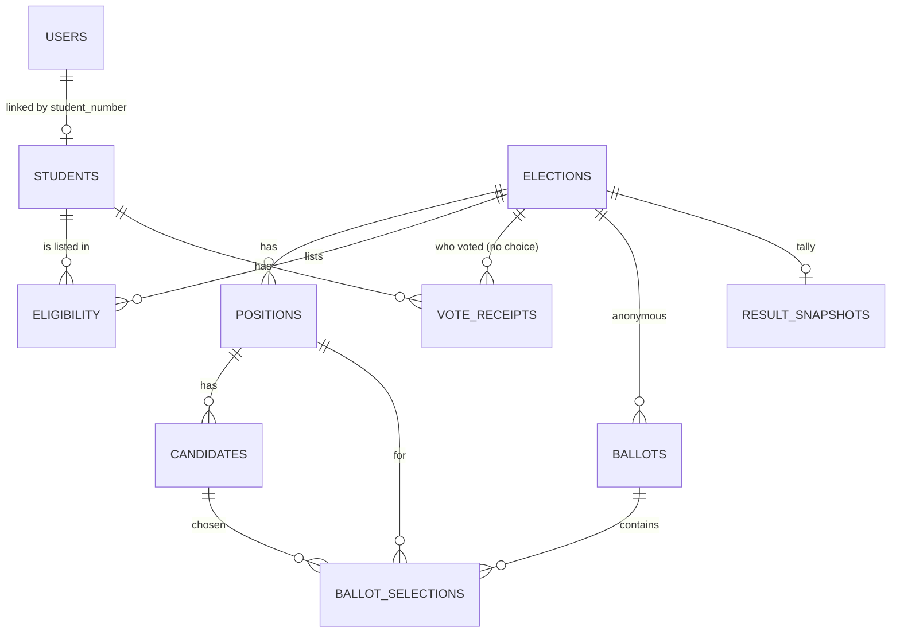

# Team 41 – Student Election Voting: Final Phase Master Plan

Team: Mo'men Mohamed (244238) · Mohamed Osama (246405) · Mohamed Khaled (248822)
Prepared: 2026-11-18. **Deadline: Wednesday 2026-11-25 (7 days).** The 5-week timeline in §11.2 is superseded: follow `docs/seven-day-schedule.md` (Lean core scope). Repo scaffold is already generated.

---

## 0. Read this first (the 8 decisions that matter)

1. **Deploy on Floci, keep Neon as the main database.** Frontend in S3, API Gateway in front, **three Lambda functions (one per service)**, Neon Postgres as system of record, plus DynamoDB / SQS / Secrets Manager / EventBridge Scheduler / CloudWatch where each one has a real job. This is the "full marks" shape in the brief; Vercel+Neon only is explicitly the minimum submission.
2. **Keep a Vercel + Neon fallback build** of the same Express code (Lab 5 route). It costs ~half a day and protects you if Floci misbehaves on demo day.
3. **Fix vote secrecy** (the feedback flagged `Ballot.student_id` → `Vote Selection`). Split into `vote_receipts` (who voted) and `ballots/ballot_selections` (what was chosen) with **no link between them** (§6).
4. **Add a third role: AUDITOR.** Admins run elections; only Auditors read audit logs. Separation of duties answers "admin tampering" and gives Service 3 real meaning.
5. **Election lifecycle is a state machine, enforced in the backend, advanced automatically by EventBridge Scheduler** (§5). This answers "voting window can be edited while voting", "candidates deleted after votes", "does status change automatically", and "no publish step".
6. **Auth is decided:** self-issued JWT (HS256), bcrypt passwords, secret in Secrets Manager, 30-min expiry, revocation list, role checked in backend (§8). Cognito is a stretch goal, not the plan.
7. **Add real external integrations** (feedback: "Turnstile is a security control, need more"): Cloudflare Turnstile + an **email API** (OTP verification, vote receipt, results-published notice) + **Have I Been Pwned password check** (§7).
8. **Every student must have commits, AWS services and tests for their own service.** Each service below already has ≥5 AWS pieces so nobody is below the "minimum 3 AWS services per student" rule.

**Academic-integrity warning:** the brief (§11) says AI use follows module rules and that you must be able to explain every line in the oral discussion. Check the module's announced AI rules before using generated code, and make each owner write/understand their own service. Marks are 50% individual and attendance is compulsory (0% if absent).

---

## 1. What the requirements demand (checklist)

**Minimum project (from the announcement + brief)**
- [ ] One web app, browser frontend → real API (no hard-coded data). Only Node.js + Express + HTML/CSS/JS (or React).
- [ ] 3 services, each owned by one student, ≥3 meaningful related functions, **not CRUD-only**, **connected to each other**.
- [ ] REST with correct verbs, validation, status codes.
- [ ] Persistent DB with C/R/U/D/query.
- [ ] ≥2 roles enforced in backend (hiding buttons doesn't count).
- [ ] ≥1 external API doing a real job in a workflow.
- [ ] Auth on protected functions, ownership checks, no hard-coded secrets (also not in git history).
- [ ] Logging + monitoring evidence, threat model ≥6 threats, ≥8 documented security tests.
- [ ] Deployed on Floci (or equivalent), **each student ≥3 AWS services in their component**; Neon with Floci recommended.
- [ ] Public GitHub repo, no secrets, per-member commit history.
- [ ] ≤5-minute demo video (anyone-with-link), main scenario first, then security scenarios, no commentary needed.
- [ ] Live demo + individual discussion (compulsory).

**Report sections (all mandatory)** – map to this file
| # | Section | Where in this plan |
|---|---|---|
| 1 | Problem definition | §3 |
| 2 | Architecture diagram (cloud services labelled, external API shown) | §4 |
| 3 | Service/API list + ER diagram + CRUD per service | §5, §6 |
| 4 | Role/permission matrix | §8.1 |
| 5 | External integration + secret storage | §7 |
| 6 | Deployment approach + deployed URL | §9 |
| 7 | Threat model ≥6 mapped to controls | §8.3 |
| 8 | Security controls + shared responsibility + least-privilege rationale | §8.2, §8.4 |
| 9 | GitHub link | §12 |
| 10 | Demo video link | §13 |
| 11 | Logs/monitoring evidence | §10.1 |
| 12 | Security test table (≥8, with required types) | §10.2 |
| 13 | Integrated testing | §10.3 |
| 14 | Cost/resource | §9.3 |
| 15 | Recovery | §9.4 |
| 16 | Limitations | §14 |
| – | Individual Contribution Statement ×3 (end of report) | §15 |

---

## 2. Phase 1 feedback → concrete fixes

| Feedback | Fix in the final phase |
|---|---|
| Owners written as "Student 1/2/3" | Use names everywhere: **Mo'men = Election Management, Mohamed Osama = Voter Access & Voting, Mohamed Khaled = Results & Audit** (confirm this mapping matches who wanted what). |
| Sentences don't make sense ("send a POST … to the frontend", "Authentication Authentication", "Every candidate is an object of a position") | Rewrite the problem/communication text cleanly; proof-read; one person reads the whole report aloud before submission. |
| Authentication not clear / not decided | §8: JWT HS256 + bcrypt + Secrets Manager + 30 min expiry + jti revocation + rate limit + lockout. Named algorithm, token, expiry, store. |
| Turnstile is the only integration and is a security control | Add email API (OTP, receipts, notices) and HIBP password check as workflow-bearing integrations (§7). Keep Turnstile as anti-bot. |
| Ballot stores `student_id`, Vote Selection links to a candidate → DB/admin can see how a student voted | Split tables, no link, no serial IDs, no per-ballot timestamp (§6). Residual risk documented honestly. |
| Candidates deletable after votes; voting window editable while voting | State machine + guards: 409 on candidate delete once the election is past DRAFT or any ballot exists; window locked once OPEN (§5). |
| Unclear if status changes automatically or manually; "officially announced" has no publish step | Scheduler auto-OPEN/CLOSE; tally automatic on CLOSE; explicit **admin publish** endpoint, audit-logged (§5). |
| Security controls generic (no algorithm/token/expiry/rate-limit/DB role) | §8.2 gives exact values: bcrypt cost 12, JWT 30 min, 5 failures/15 min, 429 limits, DB roles, IAM policies per function. |
| Election Management was pure CRUD | Adds state machine, readiness checks, bulk eligibility import, student-roster endpoints, position/candidate listing endpoints, creator ownership checks. |
| Results & Audit: counting is a simple aggregate; audit belongs to all services | Audit becomes an SQS-fed pipeline with a hash-chained append-only store + verify endpoint + monitoring summary; tally is idempotent, hashed and snapshotted to S3. All services publish audit events; Service 3 owns the pipeline. |
| Phase 1 doc tidy-ups | Role matrix still said "Role 1/Role 2"; User entity listed twice; shared-responsibility table duplicated each cell. Don't repeat. |

---

## 3. Problem definition (section 1 of report – draft)

**Problem.** Student elections are often run with spreadsheets, forms or manual rolls: eligibility is hard to verify, people can vote twice, results leak early, and nobody can prove afterwards that the count is untampered. A voting system must also keep a ballot secret while still preventing double voting – two goals that conflict if designed carelessly.

**Solution.** A cloud-hosted web application where administrators run an election from draft to published results; verified, eligible students cast exactly one anonymous ballot inside the voting window; and independent auditors can verify the audit trail.

**Users and roles.** Admin (university election staff), Student (eligible voter), Auditor (independent reviewer, read-only on results/audit).

**Benefit.** One eligibility source, server-enforced one-vote rule, secret ballots, no early results, tamper-evident audit trail, automatic opening/closing.

**In scope:** election lifecycle, rosters, positions/candidates, registration with email verification, voting, receipts, tally, publication, audit pipeline, monitoring, deployment on Floci.
**Out of scope (with reasons):** integration with real university SSO (no access), biometric identity (out of module scope), end-to-end cryptographic verifiable voting (research-grade; documented as limitation), production-scale load.

---

## 4. Architecture (section 2)



Draw the final diagram in draw.io with these exact labels (cloud service named on every box, external APIs in a distinct colour, Neon labelled "external managed DB").

**Why Lambda per service:** fits Lab 7 (`serverless-http` wraps the Express app, ~3-line `lambda.js`), gives each owner their own deployable unit, their own IAM role, and own log group; scales to zero (cost).

**Floci facts verified from floci.io / its GitHub README (2026-11-18):** supports S3, DynamoDB, Lambda (real Docker containers), API Gateway v2, SQS, SNS, EventBridge (+Scheduler), Secrets Manager, SSM, KMS, CloudWatch Logs and Metrics/alarms, Cognito. Image `floci/floci`, port 4566.
**Not verified / must spike in Week 1:** (a) Lambda containers reaching the public internet (Neon, email API, Turnstile); (b) SQS → Lambda event source mapping; (c) EventBridge Scheduler invoking Lambda on a timer; (d) API Gateway behaviour for 429 throttling; (e) alarm evaluation. Floci does **not** document general IAM policy enforcement (only an S3 auth flag), so IAM is *defined and justified* but not provably enforced on Floci – say this honestly (§14) and enforce authorization in app code.

---

## 5. Services, endpoints and business logic (section 3)

### 5.0 Election state machine (shared contract – owned by Mo'men, enforced by all)

```
DRAFT --schedule--> SCHEDULED --(Scheduler @start_time)--> OPEN --(Scheduler @end_time | admin early-close + reason)--> CLOSED
CLOSED --(tally, automatic or admin)--> TALLIED --(admin publish)--> PUBLISHED
DRAFT/SCHEDULED --cancel--> CANCELLED
```
Rules: edit title/window only in DRAFT/SCHEDULED; positions/candidates/eligibility editable only in DRAFT (eligibility additions allowed in SCHEDULED, never OPEN); **schedule** requires readiness (≥1 position, every position ≥2 candidates, ≥1 eligible student, start in the future, duration ≥ 1 h); candidate delete → 409 if election ≠ DRAFT or any ballot exists; results to students only in PUBLISHED; admins/auditors get results from TALLIED; *turnout counts* (not tallies) visible while OPEN. Any illegal transition → 409.

### 5.1 Service 1 – Election Management (Mo'men Mohamed) · Lambda `election-svc`
Capability: *run an election lifecycle correctly.* (Business rules, not CRUD.)

| Method | Endpoint | Validates | Success | Errors | Roles |
|---|---|---|---|---|---|
| POST | /api/elections | title 3-120, window dates ISO, end>start, start in future | 201 | 400 401 403 409(dup title) | Admin |
| GET | /api/elections | query: status, search, page/limit ≤50 | 200 | 401 403 | Admin(all) / Student(eligible only) / Auditor(all) |
| GET | /api/elections/:id | uuid | 200 | 401 403 404 | per role/eligibility |
| PATCH | /api/elections/:id | whitelist fields; state guard; creator-only | 200 | 400 401 403 404 409 | Admin (creator) |
| DELETE | /api/elections/:id | DRAFT only | 204 | 401 403 404 409 | Admin (creator) |
| POST | /api/elections/:id/transition | `to` ∈ schedule/cancel/close-early(+reason ≥10 chars) | 200 | 400 401 403 404 409 | Admin (creator) |
| GET | /api/elections/:id/readiness | – | 200 (checklist) | 401 403 404 | Admin |
| POST | /api/elections/:id/positions | title, max_selections=1.. | 201 | 400 401 403 404 409 | Admin |
| GET | /api/elections/:id/positions | include candidates | 200 | 401 403 404 | Admin/Student(eligible,≥SCHEDULED)/Auditor |
| PATCH / DELETE | /api/positions/:id | DRAFT only | 200/204 | 400 401 403 404 409 | Admin |
| POST | /api/positions/:id/candidates | name 2-80, manifesto ≤1000, unique per position | 201 | 400 401 403 404 409 | Admin |
| PATCH / DELETE | /api/candidates/:id | DRAFT only; no ballots | 200/204 | 400 401 403 404 409 | Admin |
| POST | /api/candidates/:id/photo-url | content-type png/jpeg, ≤2 MB | 200 (presigned S3 PUT) | 400 401 403 404 | Admin |
| POST | /api/students | student_number format, email domain allow-list | 201 | 400 401 403 409 | Admin |
| POST | /api/students/import | array ≤500, per-row errors reported | 207/201 | 400 401 403 | Admin |
| GET | /api/students?search= | search ≤50 chars, parameterised | 200 | 401 403 | Admin |
| PATCH / DELETE | /api/students/:id | cannot delete if has receipts | 200/204 | 400 401 403 404 409 | Admin |
| PUT | /api/elections/:id/eligible-students/:studentId | state guard | 200/201 | 400 401 403 404 409 | Admin |
| DELETE | same | state guard | 204 | 401 403 404 409 | Admin |
| GET | /api/elections/:id/eligible-students | filter, paginate | 200 | 401 403 404 | Admin |
| POST | /internal/elections/:id/auto-transition | caller must present Scheduler-signed token | 200 | 401 403 409 | system only (not routed by API Gateway) |

AWS used: **API Gateway (routing/throttle/CORS config), Lambda, S3 (frontend + candidate photos), EventBridge Scheduler, IAM role, CloudWatch Logs.** Frontend: admin dashboard, election wizard, positions/candidates editor, roster page (CSV paste import), readiness checklist, status timeline.
Cross-service: emits audit events; voting-svc and results-svc call `shared/electionState` (reads Neon) to enforce the same state rules; auto-close triggers tally in Service 3.

### 5.2 Service 2 – Voter Access & Voting (Mohamed Osama) · Lambda `voting-svc`
Capability: *prove who may vote, then record exactly one secret ballot.*

| Method | Endpoint | Validates | Success | Errors | Roles |
|---|---|---|---|---|---|
| POST | /api/auth/register | student_number+email exist in roster, password ≥12, not in HIBP, Turnstile | 201 | 400 403 409 429 | public |
| POST | /api/auth/verify-email | 6-digit OTP, 10 min TTL, 5 tries | 200 | 400 401 429 | public |
| POST | /api/auth/login | Turnstile, generic error, lockout | 200 {token} | 400 401 403 423 429 | public |
| POST | /api/auth/logout | stores jti in RevokedTokens until exp | 204 | 401 | any |
| GET | /api/me | identity from JWT | 200 | 401 | any |
| GET | /api/me/elections | only elections the caller is eligible for + hasVoted flag | 200 | 401 403 | Student |
| GET | /api/elections/:id/ballot | eligible, OPEN, not voted | 200 | 401 403 404 409 | Student |
| POST | /api/elections/:id/votes | one choice per position, candidate belongs to position, count ≤ max_selections, Turnstile, **identity from JWT only** | 201 {receipt} | 400 401 403 404 409 429 | Student |
| GET | /api/elections/:id/receipt | caller's own receipt only | 200 | 401 403 404 | Student |

Vote algorithm (single Neon transaction): verify JWT → role STUDENT → Turnstile → load election, check status OPEN and `now` within window → check eligibility row → validate selections → `INSERT vote_receipts (election_id, student_id)` (UNIQUE → 23505 ⇒ 409) → `INSERT ballots (ballot_id uuid)` + `ballot_selections` → COMMIT → send audit event (`VOTE_CAST`, no candidate info) → email receipt (random receipt code, no choices). Concurrency test: 20 parallel POSTs → exactly one 201.
AWS used: **Lambda, Secrets Manager, DynamoDB (rate limits, OTP, revoked tokens, TTL), SQS (audit publisher), IAM role, CloudWatch.** External: Turnstile, email API, HIBP. Frontend: register/verify/login pages, my-elections, ballot page, receipt page. Also owns the shared `auth` middleware used by all three Lambdas.

### 5.3 Service 3 – Results & Audit (Mohamed Khaled) · Lambdas `results-svc` + `audit-writer`
Capability: *produce trustworthy, gated results and a verifiable audit trail.*

| Method | Endpoint | Validates | Success | Errors | Roles |
|---|---|---|---|---|---|
| GET | /api/elections/:id/turnout | counts only (no tallies) | 200 | 401 403 404 | Admin, Auditor |
| POST | /api/elections/:id/tally | status CLOSED; idempotent; writes SHA-256 snapshot to S3 | 200 | 401 403 404 409 | Admin / system |
| GET | /api/elections/:id/results | Admin/Auditor ≥TALLIED; Student only PUBLISHED | 200 | 401 403 404 409 | Admin, Auditor, Student |
| POST | /api/elections/:id/results/publish | status TALLIED; reason optional; emails eligible students | 200 | 401 403 404 409 | Admin |
| GET | /api/elections/:id/results/export | presigned S3 link to snapshot (+hash) | 200 | 401 403 404 409 | Admin, Auditor |
| GET | /api/audit-logs | filters election/action/actor/from/to, page ≤100 | 200 | 400 401 403 | **Auditor only** |
| GET | /api/audit-logs/verify?election= | recomputes hash chain | 200 {valid, brokenAt} | 401 403 404 | Auditor |
| GET | /api/monitoring/security-summary | counts of 401/403/login failures last 24 h | 200 | 401 403 | Auditor |
| (SQS) | audit-writer | validates event schema, strips forbidden fields, writes chained record | – | bad events → DLQ | system |

Audit record: `{pk: election_id|GLOBAL, seq, ts, actor_id, role, action, resource, outcome, ip_hash, prev_hash, hash}`. Never stores passwords, tokens, candidate choices. Events logged: LOGIN_OK/FAILED, REGISTER, ELECTION_CREATED/UPDATED/TRANSITIONED, CANDIDATE_*, ROSTER_IMPORT, VOTE_CAST, VOTE_REJECTED(reason), TALLY, PUBLISH, ACCESS_DENIED.
AWS used: **Lambda ×2, SQS (+DLQ), DynamoDB AuditLog, CloudWatch Logs + metric filter + alarm, SNS, S3 results-snapshots (versioned), IAM roles.** Frontend: turnout panel, results page with charts (plain canvas/CSS bars), audit viewer with filters + "verify chain" button, security dashboard.

---

## 6. Data model (section 3, ER)


**Key point: there is intentionally NO relationship between `VOTE_RECEIPTS` and `BALLOTS`.**

```sql
users(user_id uuid pk, student_number text unique null, email text unique, password_hash text, role text check in ('ADMIN','STUDENT','AUDITOR'), email_verified bool, failed_logins int, locked_until timestamptz, created_at)
students(student_id uuid pk, student_number text unique, full_name, email, faculty, active bool)
elections(election_id uuid pk, title unique, description, start_time, end_time, status text, created_by uuid fk users, created_at, updated_at, check(end_time > start_time))
positions(position_id uuid pk, election_id fk, title, max_selections int default 1, unique(election_id,title))
candidates(candidate_id uuid pk, position_id fk, name, manifesto, photo_key, unique(position_id,name))
eligibility(election_id fk, student_id fk, primary key(election_id,student_id))
vote_receipts(election_id fk, student_id fk, receipt_hash text, voted_on date, primary key(election_id,student_id))   -- who voted, no choice
ballots(ballot_id uuid pk default gen_random_uuid(), election_id fk)                                            -- no student, no timestamp
ballot_selections(ballot_id fk, position_id fk, candidate_id fk, primary key(ballot_id,position_id))
result_snapshots(election_id pk fk, tallied_at, json_s3_key, sha256, published_at null, published_by null)
```
Why this protects secrecy: DB/admin sees *that* a student voted, and *what ballots exist*, but cannot join them (UUID ids, no serial order, no timestamps, `voted_on` is date-only). Add two Postgres roles in Neon: `app_voting` (INSERT on receipts/ballots/selections, SELECT on elections/eligibility) and `app_results` (SELECT aggregate only); admin API has no route to `ballot_selections`. **Residual risk to document:** a DB owner with full access could still correlate via write-ahead logs or low turnout; mitigation = receipts hash only, no timestamps, minimum-turnout notice, and honest limitation (§14).

DynamoDB: `RateLimits(pk, ttl)`, `OtpCodes(email, code_hash, tries, ttl)`, `RevokedTokens(jti, ttl)`, `AuditLog(pk, seq)`.
CRUD per service: Service 1 C/R/U/D/search on elections, positions, candidates, students, eligibility; Service 2 C/R on users, receipts, ballots, selections + DynamoDB C/R/TTL-delete; Service 3 R/aggregate on ballots/selections, C on snapshots, C/R on AuditLog (no U/D by design).

---

## 7. External integrations (section 5)

| Integration | Workflow it supports | Secret storage |
|---|---|---|
| **Cloudflare Turnstile** (siteverify) | register, login, cast vote: backend rejects without a valid token (403 `BOT_CHECK_FAILED`) | secret key in Secrets Manager (Floci) / env var (fallback); site key is public. Use Cloudflare's published *test* keys locally. |
| **Email API (Brevo or Resend – pick one in Week 1; verify its current free tier & sender rules)** | email OTP at registration (proves mailbox ownership), vote receipt (no choices), results-published notification | API key in Secrets Manager |
| **Have I Been Pwned Pwned Passwords range API** | registration rejects breached passwords; sends only first 5 SHA-1 chars (k-anonymity), no key needed | none |

Each one must change application behaviour (rejects, blocks or notifies), which is what the brief calls a "real job".

---

## 8. Security design (sections 4, 7, 8)

### 8.1 Role / permission matrix (enforced in backend middleware `requireRole()` + service checks)
| Action | Anonymous | Student | Admin | Auditor |
|---|---|---|---|---|
| Register / login | ✔ (Turnstile) | – | – | – |
| Create/edit/schedule/cancel election | ✘ 401 | ✘ 403 | ✔ creator only for edit | ✘ 403 |
| Manage positions/candidates/roster/eligibility | ✘ 401 | ✘ 403 | ✔ (DRAFT rules) | ✘ 403 |
| List elections | ✘ 401 | own eligible only | all | all |
| View ballot | ✘ 401 | ✔ eligible + OPEN | ✘ 403 | ✘ 403 |
| Cast vote | ✘ 401 | ✔ once | ✘ 403 | ✘ 403 |
| Own receipt | ✘ 401 | ✔ own only (IDOR-tested) | ✘ | ✘ |
| Turnout (counts) | ✘ 401 | ✘ 403 | ✔ | ✔ |
| Results | ✘ 401 | only PUBLISHED | from TALLIED | from TALLIED |
| Publish results | ✘ 401 | ✘ 403 | ✔ | ✘ 403 |
| View audit logs / verify chain | ✘ 401 | ✘ 403 | ✘ 403 | ✔ |
| Modify/delete audit records | no API exists; IAM has no Update/Delete | | | |

### 8.2 Controls with exact values
- **Authentication:** bcryptjs cost 12 (pure JS so it zips without native builds); JWT HS256, `alg` pinned, claims `sub, role, jti, iat, exp(30 min)`; secret ≥32 bytes random in Secrets Manager (cached per cold start); logout/compromise → jti in RevokedTokens; admin/auditor accounts seeded by script (never self-registered).
- **Brute force:** 5 failed logins / 15 min per account+IP → 423/429, counters in DynamoDB TTL; generic "invalid credentials"; API Gateway throttle (e.g. 20 rps burst 40) as coarse limit; alarm on spike.
- **Authorization:** central middleware order `auth → role → ownership/state → handler`; student id/role never read from body; unknown route 404; every 401/403 emits `ACCESS_DENIED` audit + log.
- **Ownership:** receipts/eligibility via JWT subject; admin edits only elections they created; test by swapping IDs.
- **Validation:** hand-written validators like Lab 4 (type, length, ranges, enums, uuid format), unknown fields stripped (no mass assignment), JSON body ≤ 100 KB, parameterised SQL only (`$1`), uniform error format `{error:{code,message}}`, no stack traces.
- **Secrets:** `.env` ignored, `.env.example` only, Secrets Manager on Floci, gitleaks pre-commit + CI scan, scan full history before making repo public (if anything leaks: rotate and rewrite history *before* publishing – deleting later still loses marks).
- **Transport/at rest:** HTTPS on Neon and external APIs; Neon encrypts at rest; **Floci is HTTP on localhost – state that real AWS would use HTTPS via API Gateway and S3 website behind CloudFront.** Enable SSE on S3 buckets in the setup script (even if Floci ignores it, document), Secrets Manager/KMS for secrets.
- **Frontend hardening:** render user data with `textContent` (XSS), `<meta>` CSP, no tokens in URLs, token in memory/`sessionStorage`.
- **CORS:** exact origin from env (`http://localhost:4566`), no `*`.
- **Least privilege (per-role policy files in `infra/iam/`):**
  - `election-svc-role`: S3 PutObject on `election-assets/photos/*`, SQS SendMessage on audit queue, Secrets GetSecretValue on its two secrets, logs write.
  - `voting-svc-role`: DynamoDB Get/Put/Update/Delete on three tables only, SQS SendMessage, Secrets read (JWT, Turnstile, mail), logs.
  - `results-svc-role`: S3 Put/Get on `results-snapshots/*`, DynamoDB **Query only** on AuditLog, SQS SendMessage, logs.
  - `audit-writer-role`: SQS Receive/Delete on audit queue, DynamoDB **PutItem + Query** on AuditLog (no Update/Delete), logs.
  - Explain why admin-wide `*:*` is wrong: a bug or stolen token in one function would let an attacker alter votes, audit logs, secrets.

### 8.3 Threat model (≥6; here 12) – every row has an implemented control and a test
| # | Threat | Category | Control | Test |
|---|---|---|---|---|
| T1 | Credential stuffing / brute force on login | Identity | bcrypt, lockout 5/15 min, Turnstile, rate counters, alarm | ST-11 |
| T2 | Forged/tampered/expired JWT or role escalation | Identity | pinned HS256, secret in SM, exp, jti revoke, role re-checked | ST-10 |
| T3 | Double voting incl. race conditions | Data integrity | UNIQUE(election_id,student_id) + one transaction → 409 | ST-06 |
| T4 | Linking a voter to their choice via DB/admin | Data confidentiality | split tables, no FK/timestamp, DB roles | ST-16 (schema review) |
| T5 | IDOR: reading another student's receipt/eligibility | API | identity from JWT, ownership filter in SQL | ST-03 |
| T6 | Early/unauthorised results; editing window or deleting candidates after voting | Business logic | state machine guards, role gates | ST-08, ST-12 |
| T7 | SQL injection / malformed input / mass assignment | API | parameterised SQL, validators, whitelist, size limit | ST-04, ST-05 |
| T8 | Secrets committed to repo | Cloud config | env/SM, .gitignore, gitleaks, history scan | ST-09 |
| T9 | Over-permissive IAM or public bucket exposing data | Cloud config | per-function roles, bucket has frontend only, no wildcard | ST-13 |
| T10 | Audit log tampering/deletion | Data integrity | no update/delete route or IAM action, hash chain verify | ST-14 |
| T11 | Bot/automated abuse and request flooding | Availability | Turnstile, gateway throttle, 429 limiter | ST-11 |
| T12 | Stored XSS via candidate name/manifesto | Application | textContent, CSP, length limits | ST-15 |
| T13 | CORS misconfiguration | Cloud config | exact allow-list | ST-17 |

### 8.4 Shared responsibility
Provider (Floci stands in for AWS; Neon, Cloudflare, email provider): physical data-centre security; Lambda/OS/runtime patching; managed DB availability and encryption at rest; service-level availability; IAM/KMS/Secrets Manager service security.
Team: application code and business rules; authn/authz and role design; IAM policies and bucket/queue configuration; secret hygiene and rotation; input validation; logging/monitoring and alert response; backups/recovery scripts; dependency updates.

---

## 9. Deployment (sections 6, 14, 15)

### 9.1 Approach
Serverless on Floci (local AWS in Docker), with Neon as external managed Postgres. Justification: matches labs 6-7, scales to zero, separate deploy units per owner, cheap. Trade-offs: cold starts, cold Neon wake-up, Floci not a perfect AWS replica (IAM not enforced), localhost URL. Deployed URL for report: `http://localhost:4566/election-web/index.html` (API `http://<API-ID>.execute-api.localhost.floci.io:4566`). Check whether examiners accept a localhost demo; if they want a reachable URL, a tunnel tool is an option but untested – ask your module leader early.

### 9.2 Repo layout
```
election-cloud/
  frontend/            (index, login, register, admin/*, student/*, auditor/*, js/api.js, js/auth.js, css/)
  services/
    election-svc/      (routes, controllers, services, tests)   <- Mo'men
    voting-svc/        (...)                                     <- Mohamed Osama
    results-svc/ + audit-writer/                                 <- Mohamed Khaled
  shared/              (auth middleware, validators, db, audit client, electionState)   [Osama leads]
  db/                  (schema.sql, seed.sql, roles.sql)
  infra/               (floci/docker-compose.yml, iam/*.json, setup-all.sh, reset.sh, check.sh)  [Mo'men leads]
  tests/               (postman collection, security-tests.http, race-test.js)
  docs/                (report, diagrams, evidence screenshots)
  .env.example  .gitignore  README.md  CODEOWNERS
```
Git: protected `main`, branches `feat/<owner>-<topic>`, PRs reviewed by one other member, commit at least every work session. `CODEOWNERS` assigns folders → proves ownership. Don't squash everything into one commit.

### 9.3 Cost / resources
Floci, Neon free tier, Turnstile free, email API free tier (verify limits), no paid AWS. Cost control: on-demand DynamoDB, Lambda scales to zero, TTL clears OTP/rate/revoked items, small zips, Neon autosuspend (warm it before demo). Load: API Gateway throttle + Lambda concurrency limits + Neon pooler (`-pooler` host, pool max 1 per Lambda). Coursework scale: a few hundred voters is trivial; for more, raise reserved concurrency and Neon compute.

### 9.4 Recovery
Everything recreatable: `infra/setup-all.sh` (tables, queue, buckets, roles, functions, routes, scheduler), `db/schema.sql + seed.sql`, secrets re-created from `.env.example` + new values. Accidental deletion → rerun script + restore Neon (point-in-time/branch – verify window on the free plan). Compromise → rotate JWT secret (invalidates all tokens), rotate DB password/API keys, review hash-chain verify, restore snapshots from versioned S3 bucket. Show a "destroy and rebuild in <10 min" run in the evidence.

---

## 10. Evidence plan (sections 11, 12, 13)

### 10.1 Logging & monitoring
Structured JSON log per request: `{ts, requestId, service, method, path, status, ms, userHash, event}`; never body, token, password. Evidence to capture:
- CloudWatch log groups per function (`/aws/lambda/election-svc` …).
- `aws logs filter-log-events --filter-pattern '{ $.status = 403 }'` showing denied attempts.
- Metric filter `FailedLogins` + alarm (≥5 in 5 min) → SNS topic; trigger by running the brute-force test.
- Auditor UI "security summary" + verify-chain result.
Annotate each screenshot ("what it shows"). Blur nothing sensitive – make sure nothing sensitive exists.

### 10.2 Security tests (≥8 required; plan 17)
Required types in **bold**.
| ID | Scenario | Expected |
|---|---|---|
| ST-01 | **Unauthenticated** GET ballot / POST vote / GET audit-logs | 401 |
| ST-02 | **Unauthorized role:** Student POST /elections; Admin GET /audit-logs; Auditor POST /votes | 403 |
| ST-03 | **Ownership:** Student A GET receipt of Student B (change ID) | 403/404 |
| ST-04 | **Invalid input:** vote with candidate from another position, 0 or 2 picks, bad UUID, oversized body | 400/413 |
| ST-05 | SQL injection in `?search=` and login | harmless; 400/empty; no DB error |
| ST-06 | Duplicate vote + 20 parallel requests | one 201, rest 409 |
| ST-07 | Vote before start / after end / election not OPEN | 409 |
| ST-08 | Student opens results before PUBLISHED; admin before TALLIED | 403/409 |
| ST-09 | **Secret exposure review:** gitleaks on tree + full history, grep for keys, check `.env` untracked, S3 bucket listing contains no backend files | clean |
| ST-10 | Tampered JWT, `alg:none`, expired, revoked jti | 401 |
| ST-11 | Brute force login (6 tries) | 423/429 + alarm + audit events |
| ST-12 | Admin deletes candidate / edits window after OPEN or after votes | 409 |
| ST-13 | Least-privilege review: print each role policy; show no `*` actions on data; (Floci doesn't enforce, show policy simulator or app-level deny if available) | documented |
| ST-14 | Audit tamper: attempt PUT/DELETE audit route (none → 404/405); modify a stored record then run verify | verify reports `valid:false` |
| ST-15 | XSS payload as candidate name | rendered inert |
| ST-16 | Schema review: no join path receipt↔ballot | documented query |
| ST-17 | CORS from `evil.example` | no allow header |
Record: ID, scenario, expected, actual, pass/fail, evidence screenshot/response. Keep failures that you fixed (shows process).

### 10.3 Integrated testing (on the deployed app)
Main scenario: admin creates election → positions/candidates → roster import → readiness → schedule → Scheduler opens → student registers (Turnstile, OTP, HIBP) → logs in → votes → receipt email → Scheduler closes → tally → admin publishes → student sees results → auditor verifies chain. Invalid cases: ineligible student, closed election, duplicate, bad token, malformed JSON, missing fields, wrong state transitions. Use Postman collection (Lab 4 style, saved in `tests/`) + a Node race-test script. Document limitations (e.g. Floci timing, email sandbox limits).

---

## 11. Work division and schedule

### 11.1 Ownership (graded individually – each person does frontend + backend + data + security + tests + integration for their own service)
| | Mo'men (Service 1) | Mohamed Osama (Service 2) | Mohamed Khaled (Service 3) |
|---|---|---|---|
| Frontend | admin dashboard, wizard, roster, status timeline | register/login/OTP, my elections, ballot, receipt | turnout, results, audit viewer, security dashboard |
| Backend | election-svc, state machine, readiness | voting-svc, auth middleware, vote transaction | results-svc, audit-writer, tally, export |
| Data | Neon tables for elections…eligibility | users, receipts, ballots, DynamoDB tables | result_snapshots, AuditLog |
| Security | admin-only, creator check, guards, validators | JWT, lockout, Turnstile, HIBP, secrecy design | auditor-only, hash chain, monitoring, alarms |
| AWS (≥3) | API GW, Lambda, S3, Scheduler, IAM | Lambda, Secrets Mgr, DynamoDB, SQS, IAM | Lambda×2, SQS/DLQ, DynamoDB, CloudWatch, SNS, S3 |
| Shared leads | Floci infra + deployment scripts + DB setup | auth/shared lib + external API integration | logging/monitoring + report/threat model + evidence pack |
| Report | §6–§9 text, deployment | §5, §7, §8.2 | §10, §11, §12, compiled doc |

### 11.2 Timeline
**Superseded by the 7-day schedule in `docs/seven-day-schedule.md`** (deadline 2026-11-25; feature freeze Sun 22; evidence/report Mon-Tue; Wed buffer).

### 11.3 Final countdown checklist
- **T-7 days:** freeze features; all tests pass; report draft complete.
- **T-3 days:** repo public, gitleaks clean on full history; video uploaded, "anyone with link" confirmed; fallback build verified; PDF export checked.
- **T-1 day:** rebuild Floci from scratch with scripts, run `check.sh`, run main scenario; warm Neon; laptop charged, Docker image pulled, offline backup of repo and screenshots; seed data reset script ready.
- **Demo day:** start Docker 30 min early, run `check.sh`, open tabs (site, Neon, CloudWatch/Floci UI, Postman), pre-logged admin/student/auditor browser profiles.

---

## 12. GitHub rules
Public repo, no credentials ever; `.env.example` only; each member commits regularly to own folders (≥ dozens of meaningful commits each, descriptive messages, PRs); tag releases `v1-integration`, `v2-final`. If a secret is ever committed: rotate it, rewrite history before publishing. Ask a teammate to clone fresh and run README steps.

## 13. Demo video script (≤5 min, no narration needed)
0:00 login admin → create election, positions, candidates, import roster → schedule (0:50)
0:50 time jump/auto-open → student registers (Turnstile + OTP), votes, receipt (1:50)
1:50 duplicate vote → 409; student opens admin URL → 403; invalid input → 400 (2:50)
2:50 close → tally → publish → student sees results (3:30)
3:30 auditor: audit log + verify chain; CloudWatch failed-login alarm (4:30)
4:30 repo + `gitleaks` clean (5:00). Use short election windows (e.g. 2 minutes) for the demo.

## 14. Limitations (draft – extend with real findings)
- Floci does not enforce IAM; policies provided and reasoned, real AWS would enforce them → proposed: deploy to a real AWS free-tier account.
- Localhost HTTP on Floci; real deployment needs API Gateway HTTPS + CloudFront.
- Vote secrecy is "design-level" not cryptographic; DB owner/low turnout inference possible → proposed: verifiable voting scheme/mixnets (research scope).
- Identity relies on roster + email OTP, not university SSO.
- Self-managed JWT instead of Cognito; no MFA for admins → proposed: Cognito + TOTP.
- Free-tier limits on email API/Neon; cold-start latency.
- Hash chain proves tampering but isn't externally anchored → proposed: periodic anchor to S3 Object Lock.

## 15. Individual Contribution Statement template (one each, end of report)
Owned component & ≥3 functions · frontend work (pages + screenshots) · backend/API work (endpoints list + a request-flow description) · data operations (tables, C/R/U/D/search used) · security controls actually implemented (with test IDs) · tests (Postman/automated results) · integration work (what you connected to other services) · important technical decisions (why Lambda-per-service, why split ballots, etc.) · difficulties and fixes (real ones: Floci networking, Windows paths, Neon cold start) · evidence links: commits/PRs of that member. Keep claims verifiable from `git log --author`.

## 16. Oral-discussion preparation (each person)
Be ready to: trace one request end-to-end (browser → S3/APIGW → Lambda → Neon/DynamoDB → response → UI); show your IAM role and say what it cannot do; do an invalid/unauthorized scenario live; explain "compromised credential", "accidental deletion", "misconfiguration", "increased load"; explain why one-vote and secrecy both hold; explain any line of your code.

## 17. Optional stretch goals (only after everything above passes)
Cognito user pool as identity provider; KMS-encrypted secrets; Object Lock on snapshots; CSV export of audit log; Postman→Newman automated run in CI; accessibility pass.

---
### Sources checked
- Floci docs/README: https://floci.io/llms.txt · https://github.com/floci-io/floci
- Neon connection guidance (pooled `-pooler` string for Lambda; WebSocket Pool for interactive transactions; direct URL for migrations): https://neon.com/docs/guides/serverless-connection-pooling
- Your files: coursework brief, final report components, Labs 3/4/5/5-guide/7 (both), Phase 1 proposal and feedback image.
Not independently verified: current free-tier limits of the email provider and Neon history window, and the Floci items listed as spikes in §4.
